# E-commerce User Behavior Analytics

An analytics system for collecting, processing, and analyzing user clickstream data in an e-commerce application. The project combines Python, Oracle Autonomous Data Warehouse, Oracle Machine Learning, and Oracle APEX to identify behavioral patterns and visualize user activity.

## Overview

The system was developed as a master's degree project to explore how clickstream data can be transformed into actionable insights about user behavior.

The solution covers the main stages of the analytics workflow:

1. Collecting clickstream events from an e-commerce website.
2. Storing click data in an Oracle database.
3. Transforming raw events into session-level and behavioral features.
4. Applying K-Means clustering to identify groups of user sessions.
5. Visualizing activity patterns and clustering results in interactive dashboards.

## Architecture

The analytical workflow consists of the following components:

- **E-commerce application** — the source of user navigation events.
- **JavaScript tracking** — captures interactions and sends event data for storage.
- **Python** — supports clickstream data generation for testing and experimentation.
- **Oracle Autonomous Data Warehouse** — stores clickstream records and processes them using SQL.
- **Oracle Machine Learning** — builds K-Means clustering models.
- **Oracle APEX** — provides dashboards for exploring user activity and behavioral segments.

## Screenshots

> **Note on screenshots:** The screenshots are based on materials from the original academic project. Some images were edited using AI-assisted tools to translate Ukrainian text and prepare the visuals for this portfolio. This editing affected image quality and the legibility of some text. Therefore, certain details may be less readable than in the original materials. The screenshots are provided for illustrative and documentation purposes.

### System Architecture and Data Collection

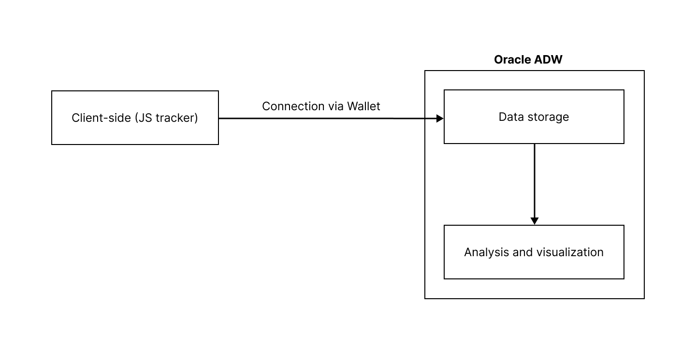

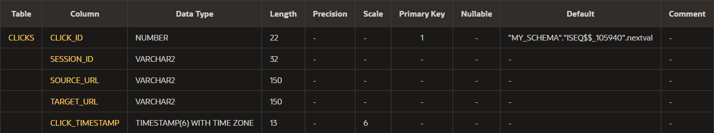

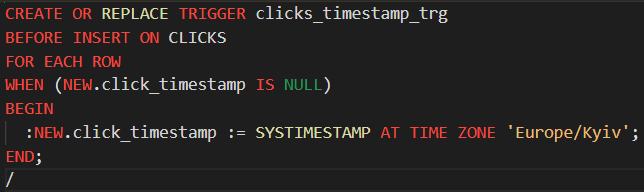

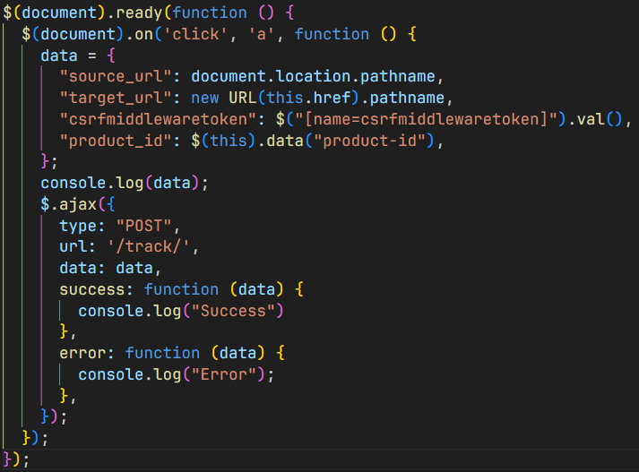

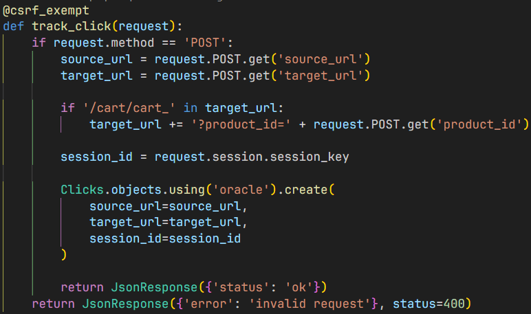

### Analytics Dashboard

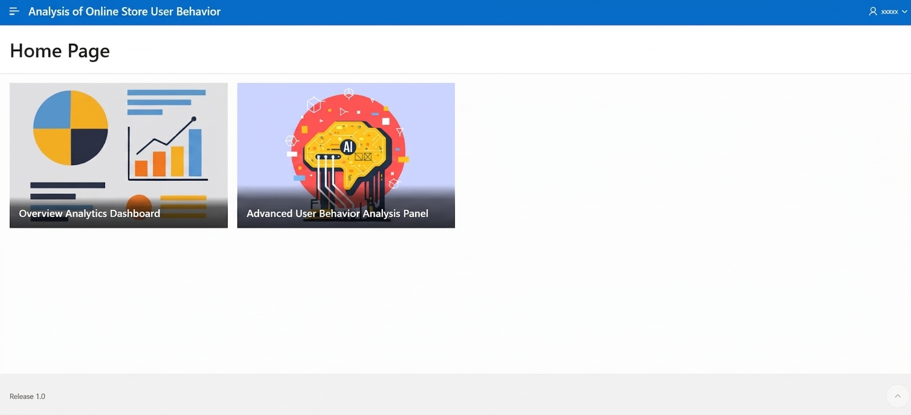

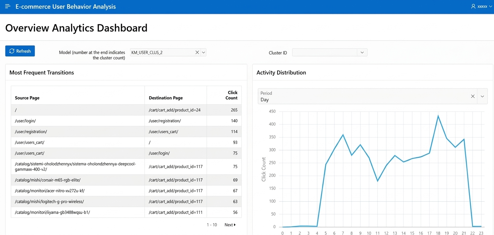

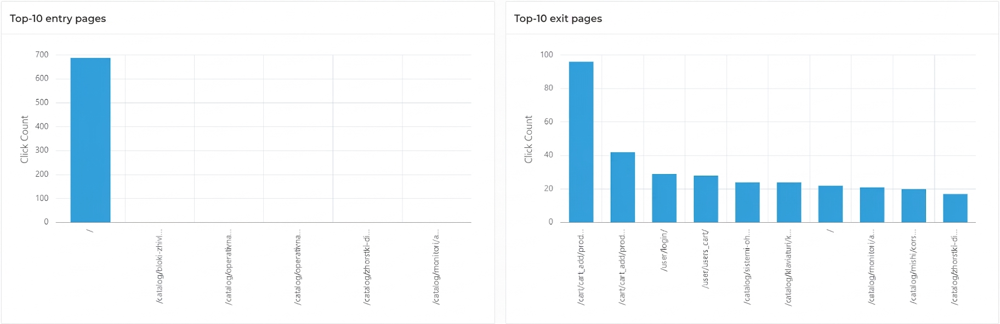

### Machine Learning and Behavioral Analysis

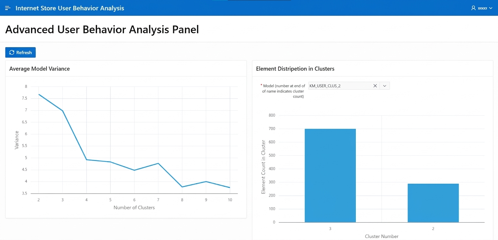

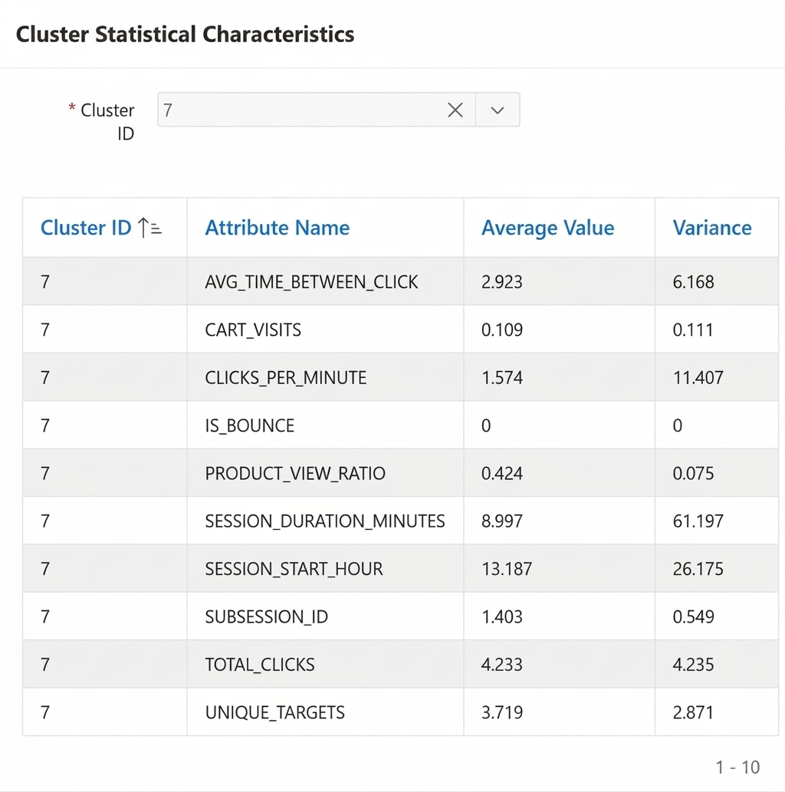

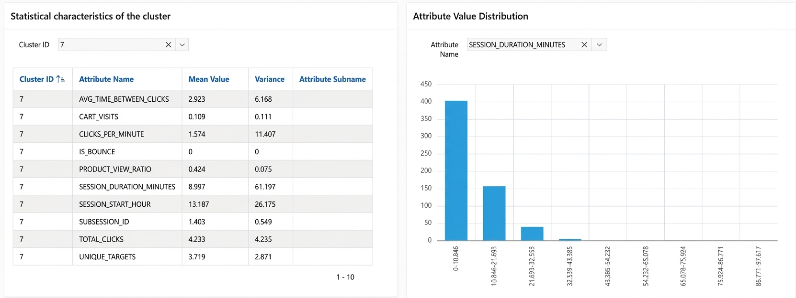

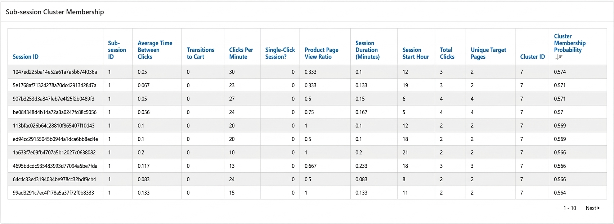

### Development Environment

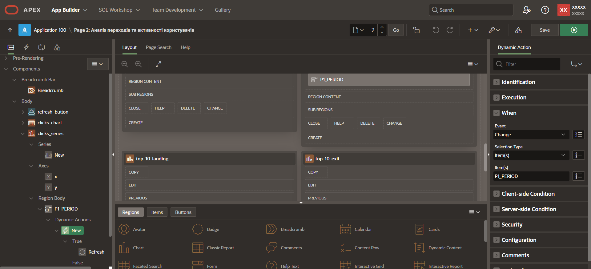

## Demo

A video demonstration of the analytics application is available on Google Drive.

The video shows the original Ukrainian-language interface of the Oracle APEX application, including user activity dashboards and behavioral clustering results.

[Watch the project demonstration](https://drive.google.com/file/d/1th4kkv-jRUYFjT9vk_8U20RlFzY-FwMY/view?usp=sharing)

## Key Features

- Clickstream data collection and storage.
- Session segmentation based on inactivity intervals.
- SQL-based feature engineering for user behavior analysis.
- K-Means clustering with different numbers of clusters.
- Interactive dashboards for exploring user activity and cluster characteristics.
- Synthetic clickstream generation for testing the analytics workflow without relying on an existing customer base.

## Technology Stack

- **Language:** Python, SQL, PL/SQL, JavaScript
- **Database:** Oracle Autonomous Data Warehouse
- **Machine Learning:** Oracle Machine Learning, K-Means clustering
- **Analytics and Visualization:** Oracle APEX
- **Source Application:** Django-based e-commerce website

## Repository Structure

```text
clickstream-analytics/
├── docs/
│   ├── architecture.md
│   └── screenshots/
├── python/
├── sql/
├── README.md
└── requirements.txt
```

## Project Status

This repository documents an academic project. The original Oracle environment is no longer available, so the complete system cannot currently be reproduced end to end.

The repository is being organized to preserve the relevant implementation code, SQL scripts, architecture documentation, and selected screenshots from the project.

Synthetic clickstream data was used for experimentation; the analytical results should not be interpreted as findings from a real customer dataset.